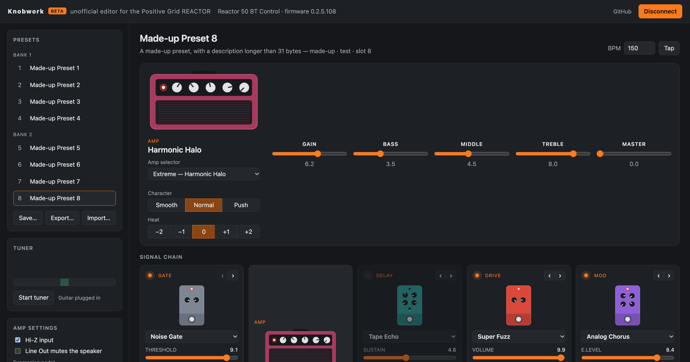

# Knobwork

**Beta.** Open it at **https://dgkanatsios.github.io/knobwork/**. Found a problem?
[Open an issue](https://github.com/dgkanatsios/knobwork/issues).



An unofficial web app for editing the Positive Grid REACTOR guitar amp over Bluetooth, and the JavaScript library that
speaks the amp's protocol. It is plain HTML and JavaScript: no build step, no dependencies, so it can be hosted as is
(for example on GitHub Pages).

> Knobwork is an independent project. It is not affiliated with, sponsored by or endorsed by Positive Grid. Positive
> Grid and REACTOR are trademarks of Positive Grid LLC, used here only to say which amp Knobwork works with.

## Using it

1. Turn the amp on, and close the Positive Grid app on your phone or tablet, so that only this app connects to the amp.
2. Open https://dgkanatsios.github.io/knobwork/ in a browser with Web Bluetooth: **Chrome** or **Edge** on macOS or
   Windows, or **Chrome** on ChromeOS or Android. On Linux, first enable Web Bluetooth at
   `chrome://flags/#enable-experimental-web-platform-features`. On iPhone and iPad, use the Bluefy browser. Safari and
   Firefox do not support Web Bluetooth. So far it has been tested only with Edge on a Mac; Chrome uses the same engine,
   so it should work the same.
3. Press **Connect**, pick the amp ("Reactor 50 BT Control") and press **Pair**.

What it does:

- **Presets:** list and select the 8 slots; save the current sound to any slot, optionally under a new name; export it
  to a `.knobwork.json` file and import it again (an imported preset plays as a temporary preset until you save it).
- **Amp:** amp selector, the five front-panel knobs, and the Character (Smooth/Push) and Heat switches.
- **Signal chain:** every block with on/off, model, every parameter the official app shows, and moving blocks within
  the chain.
- **Pictures** of the amp and of every effect as a pedal, drawn by the app. Their knobs turn with the settings.
- **Tempo** (with tap), **tuner**, and the amp settings (Hi-Z input, Line Out speaker mute, expression pedal mode).
- Changes made on the amp itself (knobs and buttons) show up live. A REACTOR Control footswitch was not tested.
- **Safety:** before a save, the app keeps what the slot held, so you can undo the save or download the old preset;
  after it, the app reads the slot back to check it. The library sends only the requests it builds itself, writes
  only to the preset slots and their amps (never the built-in amps), and refuses out-of-range values. Disconnecting
  switches the tuner off, so the amp is not left in tuner mode.

## Running it locally

```
npm start        # serves this folder at http://localhost:8080
```

Web Bluetooth only works on `https://` pages or on `localhost`. Any static file server works.

## The protocol

[docs/protocol.md](docs/protocol.md) is an unofficial description of the protocol of the REACTOR 50 (firmware
0.2.5.108), written from what the amp did and from its traffic with the official app: framing, the commands checked on
the amp, the events the amp sends, preset and amp data, amp variants and how they are written, checksums, effect models
and parameters, and the amp's behaviour. Firmware updates are not covered.

The library in [src/protocol](src/protocol) implements:

- the framing, the preset and amp formats, the checksums and the difference messages;
- the events the amp sends;
- requests to read and edit presets, amps, effects, the tempo, the tuner and the amp's settings.

`ReactorClient` sends reads and the changes that `Requests` builds, and refuses any other command. It works with any
transport that can write bytes and deliver notifications;
[src/transport/web-bluetooth.js](src/transport/web-bluetooth.js) is the browser one.

```js
import { ReactorClient, Requests } from './src/protocol/index.js';
import { WebBluetoothTransport } from './src/transport/web-bluetooth.js';

const client = new ReactorClient(await WebBluetoothTransport.request());
const preset = await client.currentPreset();
await client.setParam('MonoReverb', 0, 0.4);
client.on((event) => console.log(event)); // e.g. { type: 'paramChanged', dsp: 'Amp.Preamp', index: 0, value: 0.62 }
await client.send(Requests.setTuner(true));
```

## Tests

```
npm test
```

The unit tests check the library against traffic captured between the official app and the amp, and against made-up
presets and amp data in the amp's formats:

- 167 captured app writes, covering every kind of request the app sent apart from uploads, are rebuilt byte for byte;
- uploads and multi-part replies are split into parts exactly as the app and the amp split them;
- made-up presets and the 15 variants of a made-up amp round-trip exactly, and saving one sends the expected messages.

[selftest.html](selftest.html) runs the library against a connected amp: its reads, edits, model changes, tempo,
tuner, settings, amp character, a temporary preset load and saves. It writes preset slots and their amp banks only with
data identical to what is already stored. It changes settings and the working amp bank `7F` (including a deliberately
corrupted difference message) only temporarily. It puts everything back (including unsaved changes that were loaded as
a temporary preset) and then compares every preset, amp bank and setting with a snapshot taken at the start. It is not
on the public site: run it locally with `npm start` and open http://localhost:8080/selftest.html.

## Contributing

[AGENTS.md](AGENTS.md) describes the project's conventions and the safety rules for code that talks to the amp. They
apply to people and AI agents alike. Run `npm test` before every commit.

## License

The code and documentation are released under the [MIT License](LICENSE). The license does not cover the presets
and amps you read or export from an amp. Positive Grid and REACTOR are trademarks of Positive Grid LLC. Names of amps,
effects and other products belong to their owners and are used only to identify them.

The test data in [test/fixtures](test/fixtures) contains no presets or amp data from Positive Grid: the presets and amp
data are made up, and the captured traffic holds only requests, acknowledgements and events.
